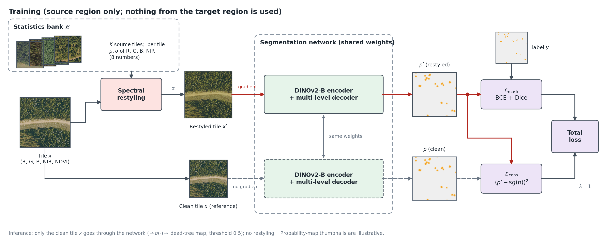
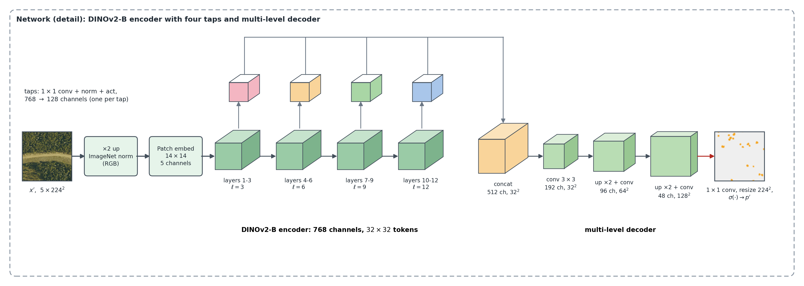
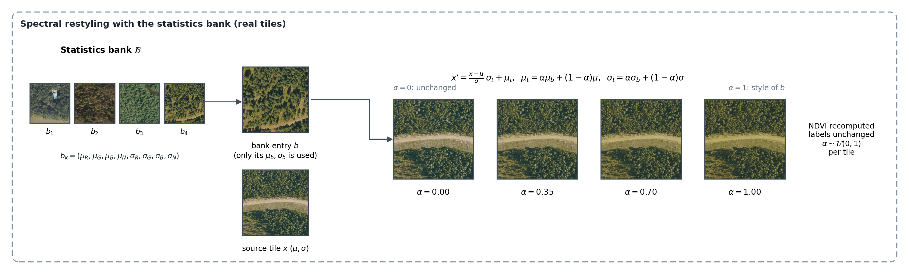

# iTwin-Forest

Single-source domain generalisation for dead-tree segmentation on aerial imagery ([TreeFinder](https://github.com/zhwang0/treefinder) / NAIP, 224×224 tiles).
Train on one region, test on regions never seen during training.

iTwin-Forest = **DINOv2 + decoder** + **spectral statistics bank** + **consistency loss**.



1. **DINOv2 + decoder.** DINOv2 ViT-B/14 on the 5-channel tile (R, G, B, NIR, NDVI), upsampled ×2. Hidden states of layers 3/6/9/12 feed a light
   multi-level convolutional decoder (≈1.5 M parameters). The encoder learning rate is `encoder_mult × lr` (0.1 or 0.01).
   
2. **Statistics bank.** For every training tile of the source region we store the mean and standard deviation of R, G, B, NIR (8 numbers).
   During training each tile is restyled towards a tile drawn from the bank, `a ~ U(0,1)` per tile, NDVI recomputed, labels unchanged.
   Only source-domain statistics are used; nothing from the target region.
   
3. **Consistency loss.** `mean((p' − sg(p))²)` over valid pixels between the prediction on the restyled tile `p'` and on the clean tile `p`
   (`sg` = stop-gradient), weight λ = 1. Inference is the plain network on the clean tile.

Mask loss: BCE + Dice (Dice pooled over the batch, valid pixels only, no factor 2 in the numerator).

## Install

```bash
pip install -r requirements.txt
```

## Data

Download TreeFinder (CC BY 4.0, see the [dataset repository](https://github.com/zhwang0/treefinder)) so that

```
datasets/
  tile_info224_v3.csv
  tiles224_v3/*.tif        # bands R, G, B, NIR, label (0 / 1 / 255 = no data)
```

## Scenarios

| `--scenario` | train | test |
|---|---|---|
| `random` | tile-level random split (split seed 2025) | held-out tiles |
| `co` | Colorado | all other states |
| `ew` | eastern states | western states |
| `we` | western states | eastern states |
| `site` | site-disjoint split: all tiles of one source image stay in one partition (partition seed 2025; 690 / 111 / 197 sites) | held-out sites |

For `co`/`ew`/`we` the validation set is a random 10 % of the training tiles. The metric is the pooled pixel F1 (also P, R, IoU) of the
dead-tree class at threshold 0.5.

## Run

```bash
python scripts/tile_band_stats.py --data_root datasets            # optional: otherwise built on the first run
python -m itwin_forest.train --data_root datasets --scenario co --seed 2025                          # iTwin-Forest
python -m itwin_forest.train --data_root datasets --scenario co --seed 2025 --encoder_mult 0.1       # iTwin-Forest (m = 0.1)
python -m itwin_forest.train --data_root datasets --scenario co --seed 2025 --no_bank --cons 0 --tag plain   # DINOv2 + decoder only
python -m itwin_forest.train --data_root datasets --scenario co --seed 2025 --cons 0 --tag bank      # + statistics bank, no consistency loss
bash scripts/run_all.sh datasets                                  # 5 scenarios × 3 seeds
python scripts/aggregate.py runs                                  # mean ± std over seeds
```

Colour-shift robustness of a trained checkpoint (no retraining):

```bash
python -m itwin_forest.style_shift_eval --data_root datasets --scenario co --ckpt runs/co_itwin_forest_s2025/best.pth --out shift.json
```

Recipe: AdamW (weight decay 0.01), decoder lr 1e-4, ExponentialLR 0.95, batch 32, ≤100 epochs, early stopping (patience 10) on the
validation mask loss, bf16 autocast for training, fp32 for the final test evaluation.

## Results

Dead-tree F1 (%), mean ± sample std over three training seeds (2025, 2024, 2023).

| Scenario | DINOv2 + decoder (m = 0.01) | iTwin-Forest (m = 0.01) | TreeMortSeg (re-run from the released code) |
|---|---|---|---|
| Random | 66.14 ± 0.48 | 65.65 ± 0.26 | 63.31 ± 2.67 |
| CO → non-CO | 26.34 ± 0.89 | 27.27 ± 0.91 | 17.83 ± 0.84 |
| East → West | 38.69 ± 0.74 | 39.18 ± 0.43 | 29.26 ± 1.23 |
| West → East | 29.76 ± 1.49 | 30.71 ± 2.55 | 21.96 ± 0.36 |
| Site-disjoint | 43.58 ± 5.34 | 43.20 ± 5.10 | 32.99 ± 1.87 |

The statistics bank and the consistency loss change the F1 only slightly; their effect is clearer under controlled colour shifts of the test tiles
(`itwin_forest/style_shift_eval.py`), e.g. a red/blue colour cast (R×1.2, B×0.8) on CO → non-CO.

## Layout

```
itwin_forest/data.py            tiles, scenarios and splits
itwin_forest/stats_bank.py      statistics bank and restyling
itwin_forest/model.py           DINOv2 + decoder
itwin_forest/losses.py          mask loss and consistency loss
itwin_forest/metrics.py         pooled pixel metrics
itwin_forest/train.py           training / evaluation
itwin_forest/style_shift_eval.py   controlled colour-shift evaluation
scripts/                   band-statistics table, run-all, aggregation
tests/test_core.py         unit tests (splits, restyling, losses)
```

## Acknowledgements

Data: TreeFinder (Wang et al.), CC BY 4.0. Encoder weights: DINOv2 (Oquab et al.), loaded from `facebook/dinov2-base` via Hugging Face Transformers.
This repository contains only the code of iTwin-Forest.

## License

MIT (code). The dataset and the pretrained weights keep their own licenses.
